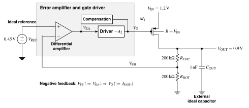
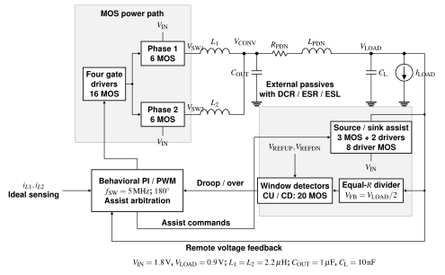

# 130 nm CMOS Power Delivery: LDO and PDN-Aware Two-Phase Buck

Two circuit studies connect transistor sizing and feedback design with supply-transient verification: an analog LDO and a two-phase Buck with local source/sink assist at a remote load. Both were developed in Virtuoso and simulated in Spectre.

## Research direction

Alan Roth and colleagues' work on in-package regulation for HPC chiplets motivates the LDO and PDN-aware Buck studies here, particularly their focus on load droop and recovery. [VLSI Technology 2020 paper](https://ieeexplore.ieee.org/document/9265105)

A planned follow-up will explore 48 V-to-1 V conversion using a switched-capacitor ladder and capacitor-assisted dual-inductor filtering, drawing on work by Chen Chen, Jin Liu, and Hoi Lee at UT Dallas. [ISSCC 2022 paper](https://ieeexplore.ieee.org/document/9731764/)

**[Technical report](docs/technical-brief.pdf)** · **[Circuit atlas](report/circuit-atlas.pdf)** · **[Editable LaTeX and build instructions](report/README.md)**

The published evidence belongs to **LDO r6 and Buck r8/r9**. These historical schematic-level experiments are separate from later local LDO development.

| Study | Circuit implementation | Selected result and condition |
| --- | --- | --- |
| [Analog LDO, r6](projects/ldo-130nm/README.md) | 9 MOS instances; 1.2 V to 0.9 V; 0.1–5 mA load | 63.89° minimum native PM in the 45-point 1.2 V matrix; nominal 100 ns load-up: 126.823 mV undershoot and 1.690 us recovery |
| [Two-phase Buck, r8](projects/two-phase-buck/README.md) | 59 MOS instances plus behavioral control; 1.8 V to 0.9 V; 5 MHz per phase | Nominal 100 ns load-up: assist changes droop from 143.37 to 107.39 mV, while recovery increases from 7.55 to 13.74 us |
| [Buck gate-resistance study, r9](projects/two-phase-buck/results.md) | Same MOS dimensions; revised source/sink gate resistance | Hard-PDN unload: 87.13 mV OFF versus 94.55 mV ON; the overshoot penalty remains |

The quoted LDO transient uses an external ideal 1 nF output capacitor. Buck OFF/ON values are paired within each revision. Recovery definitions differ between the studies; their detailed result pages retain the conditions, measurement windows, FoM equations and adverse cases.

## Read the design

The six-page technical report presents the measurements and design tradeoffs. The circuit atlas presents the architecture and transistor circuits as editable **American CircuitikZ** drawings, with PDF and white-background SVG exports from the same sources.

| Question | Open |
| --- | --- |
| How do the power path, control and feedback work? | [Architecture and block functions](docs/architecture.md) |
| What are the connections and dimensions? | [LDO circuit: all 9 instances](projects/ldo-130nm/design.md) · [Buck circuit: all 59 instances](projects/two-phase-buck/design.md) |
| What passed, what failed, and how was it measured? | [LDO results](projects/ldo-130nm/results.md) · [Buck results](projects/two-phase-buck/results.md) |
| How are the vector drawings edited and built? | [Circuit sources and drawing profile](report/README.md) |
| How can the saved numerical results be reproduced? | [Offline reproduction guide](docs/reproducibility.md) |
| How can a new Spectre run be staged? | [Simulator inputs and Cadence tools](docs/simulation-inputs.md) |





The circuit drawings use black linework, white blocks, restrained gray grouping and mathematical terminal labels. Full sizing tables disclose unit W/L, parallel multiplicity, finger count and total width. Drawn device dimensions do not establish layout area.

## Reproduce the saved results

Python 3.10 or later is sufficient for numerical verification. From the repository root:

```sh
python tools/verify_repository.py
python tests/test_download.py
python tools/reproduce_all.py --no-plots --outdir reproduced/numerical
```

The LDO analysis remeasures retained transient samples. The Buck analysis checks retained measurement tables and matched-pair arithmetic; its display traces are not used to remeasure energy or recovery. Neither command starts a simulator.

For plots and the technical report:

```sh
python -m pip install -r requirements.txt
python tools/reproduce_all.py --outdir reproduced/with-plots
python tools/build_technical_brief.py --output reproduced/technical-brief.pdf
```

Rebuilding the CircuitikZ drawings additionally requires LaTeX and Poppler; see the [figure build guide](report/README.md). Use fresh analysis output directories.

## Verification scope

The LDO amplifier, driver and pass element use transistor models. Buck bridges, gate drivers, window detectors and assist devices use transistor models; PI/PWM control and current sensing are behavioral. Ideal references and external passive-network assumptions are identified in each study.

This release supports schematic-level analysis of the stated revisions. It does not establish layout/PEX closure, silicon performance, physical package extraction or complete Buck efficiency. A new transistor simulation requires a compatible technology installation, simulator and configured design/netlist. See [validation scope](docs/validation-scope.md).
