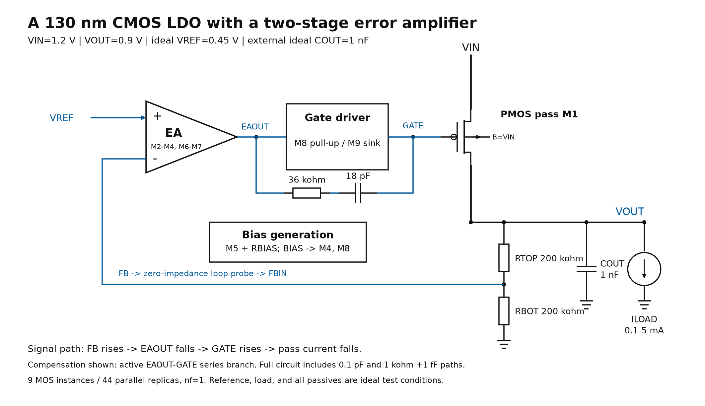

# CMOS Power Delivery: Circuit Design and Verification

Two **130 nm CMOS** circuit studies developed in Cadence Virtuoso and evaluated with Spectre: a transistor-level analog LDO and a PDN-aware two-phase Buck with fast transient assist. The presentation connects architecture, block operation, complete device sizing, performance figures and reproducible numerical analysis.

**[Download the two-column technical report](docs/technical-brief.pdf)**

| Study | Circuit implementation | Verification evidence |
| --- | --- | --- |
| [Analog LDO](projects/ldo-130nm/README.md) | 9 MOS instances: differential amplifier, bias, driver and PMOS pass stage | 164 static/DC configurations; 10 transient runs; native loop analysis, PSRR, noise and disclosed transient FoM definitions |
| [Two-phase Buck with transient assist](projects/two-phase-buck/README.md) | 59 MOS instances: two power bridges, six drivers, two window comparators and source/sink assist; behavioral control | 47 main cases + 8 gate-resistance cases; matched assist comparisons, normalized transient metrics and solver sensitivity |

## Architecture and implementation




Each study includes block-by-block operation, transistor connectivity, **unit W/L, parallel multiplicity, finger count and total width**. All 9 LDO and 59 Buck MOS instances are listed individually. These are drawn dimensions; layout area is not inferred from W/L.

## Performance interpretation

The LDO evaluates bias/headroom, compensation, external capacitance and load-step tradeoffs. Its literature-defined FoM equations state the voltage excursion, current denominator and quiescent-current convention. Recovery time is reported separately.

The Buck evaluates the remote-load response and finite transient-assist path. Its matched-condition metrics include normalized peak deviation, recovery in nominal switching cycles and modeled event energy. These expose the tradeoff between smaller droop, recovery and unload overshoot. Complete physical efficiency and area-based metrics remain unavailable.

Both studies retain adverse results: small-capacitance LDO failures, limited low-supply headroom, hard-PDN Buck unload overshoot and numerical sensitivity. Completed-case counts describe verification coverage.

## Reproduce the published analysis

Use Python 3.10 or later. Core numerical checks use the standard library. Install the plotting dependency if plots are needed:

```sh
python -m pip install -r requirements.txt
python tools/verify_release.py
python tools/reproduce_all.py --outdir reproduced
```

The scripts read the published exports and write fresh analysis outputs. They do not launch Virtuoso, Spectre, a virtual machine, or any remote connection.

Regenerate the six-page technical report with `python -B tools/build_technical_brief.py`. Its tables use the published numerical exports and the complete device inventory; ReportLab is the additional document dependency.

## Simulation scope

The original designs were simulated with real licensed transistor models. Connectivity and geometry tables describe the implemented circuits.

The included scripts reproduce analysis of the published simulation exports. A new transistor simulation requires an authorized technology setup, simulator, and configured design/netlist.

These results are pre-layout simulation. They do not establish silicon measurements, extracted package behavior, physical reliability, or complete switching-loop signoff. Full physical Buck efficiency is not reported because all controller, reference, and sensing power is not modeled.

See [validation scope](docs/validation-scope.md) and the project-specific measurement definitions for details.
