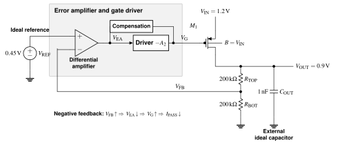
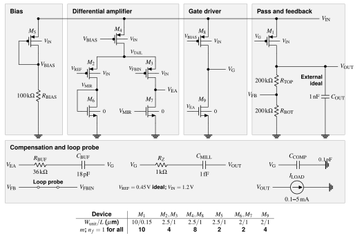
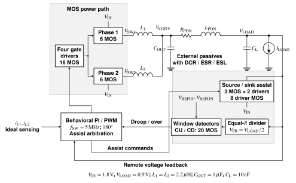

# Architecture and block functions

[Portfolio](../README.md) · [Circuit atlas](../report/circuit-atlas.pdf) · [Editable sources](../report/README.md)

The LDO and Buck are separate historical studies with different circuit revisions, operating conditions and verification coverage. They are not a jointly simulated cascaded power system.

## Analog LDO: r6

An ideal 0.45 V reference and equal 200 kohm feedback resistors set the 0.9 V target. A PMOS-input differential amplifier drives a common-source gate driver and a PMOS pass device. Nominal input is 1.2 V; the tested load range is 100 uA to 5 mA.

| Block | Function | Main tradeoff |
| --- | --- | --- |
| Bias and differential amplifier | Establish bias and compare the reference with feedback | Gain, supply headroom and temperature sensitivity |
| Gate driver and pass device | Charge the pass gate and supply the output | Drive authority, gate capacitance, dropout and quiescent current |
| Compensation and feedback | Shape the loop response and set output voltage | Stability across load and external output capacitance |
| Output capacitor and load bench | Supply transient charge and apply current demand | Primary excursion, secondary droop and finite-window recovery |

The negative-feedback direction is **FB rises → EAOUT falls → driver sink current falls → pass gate rises → pass conduction falls → VOUT falls**.

Matching net labels denote electrical connections. Filled dots mark junctions; an unmarked crossing is not a connection. The [complete design](../projects/ldo-130nm/design.md) and [circuit JSON](../projects/ldo-130nm/data/circuit.json) retain all D/G/S/B connections, device sizes and passive values. COUT is an external ideal test component: 1 nF nominal, with 100 pF and 10 pF studied separately.

## Two-phase Buck: r8/r9

Two interleaved synchronous bridges feed VCONV through separate 2.2 uH inductors. A parameterized PDN connects VCONV to the remote VLOAD node. Feedback and primary transient measurements use VLOAD. Nominal operation is 1.8 V input, 0.9 V output and 5 MHz per phase, with 1 uF converter-side and 10 nF load-side capacitance.

| Block | Implementation | Function |
| --- | --- | --- |
| Two bridges | 12 MOS instances | Switch power into the two inductors |
| Six gate-driver chains | 24 MOS instances | Drive the bridge and assist gate capacitances |
| Two voltage-window detectors | 20 MOS instances | Detect low/high load-side voltage excursions |
| Source/sink assist | 3 MOS instances | Deliver or remove charge directly at VLOAD |
| PI/PWM and arbitration | Verilog-A; ideal current sensing | Generate phase commands and coordinate assist handoff |
| PDN and external passives | Parameterized network | Expose droop and ringing under the declared R/L/C conditions |

The selected ON mode combines local MOS assist with a change in the PI state. Its improvement cannot be attributed to either mechanism alone. Revision r9 retains all 59 MOS dimensions and adds 1 kohm/2 kohm source/sink gate resistances.

The circuit is divided into [power and assist](../report/figures/buck-power.svg), [gate drivers](../report/figures/buck-driver.svg), and [window detectors](../report/figures/buck-detector.svg). Repeated circuits use explicit instance and terminal mappings. The [complete Buck design](../projects/two-phase-buck/design.md) lists every device; [r8](../projects/two-phase-buck/data/r8_hardware.csv) and [r9](../projects/two-phase-buck/data/r9_hardware.csv) inventories preserve revision-specific connections.

Read the [controller source](../projects/two-phase-buck/controller/buck_control.va) together with its [effective parameters](../projects/two-phase-buck/data/selected_parameters.json): selected-case overrides take precedence over source defaults.

## Measurements

The diagrams describe function and connectivity; they do not extend the simulation evidence. [LDO results](../projects/ldo-130nm/results.md) and [Buck results](../projects/two-phase-buck/results.md) separately define recovery, current and energy boundaries, FoMs, solver comparisons and retained failures.
