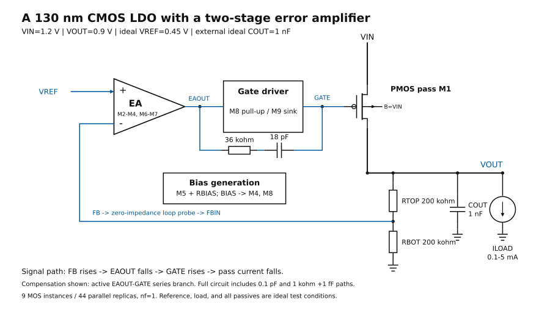
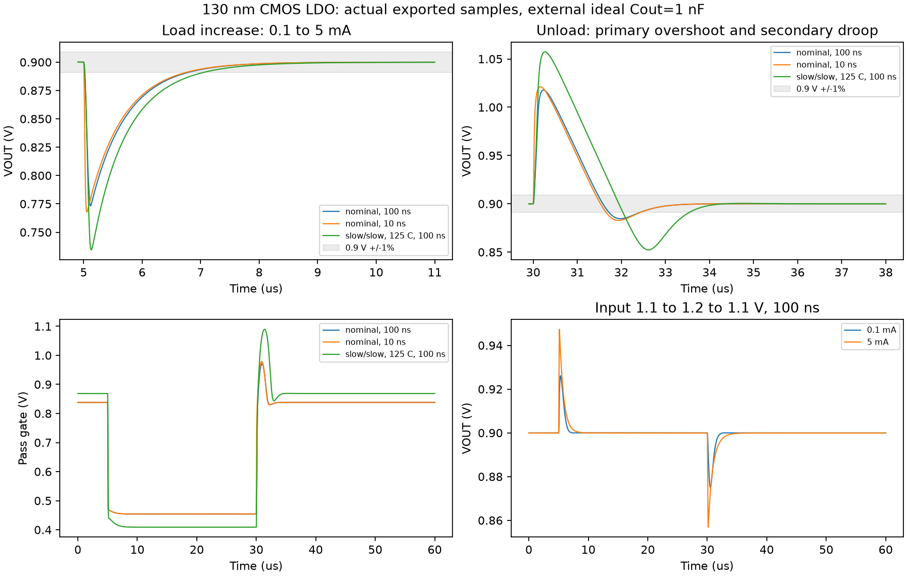
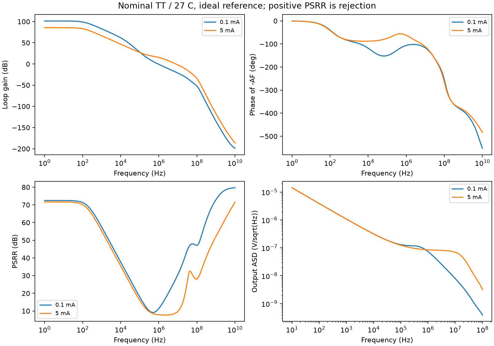
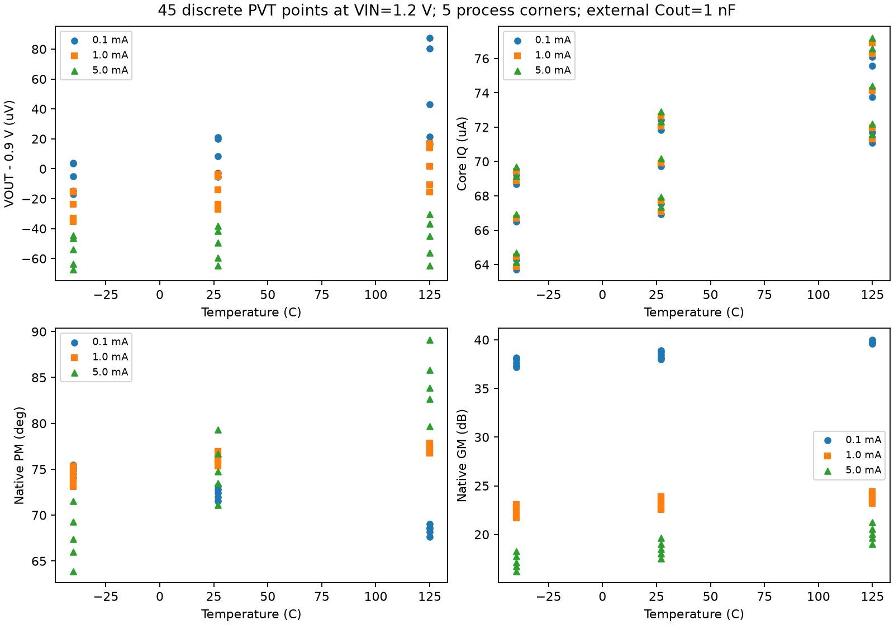
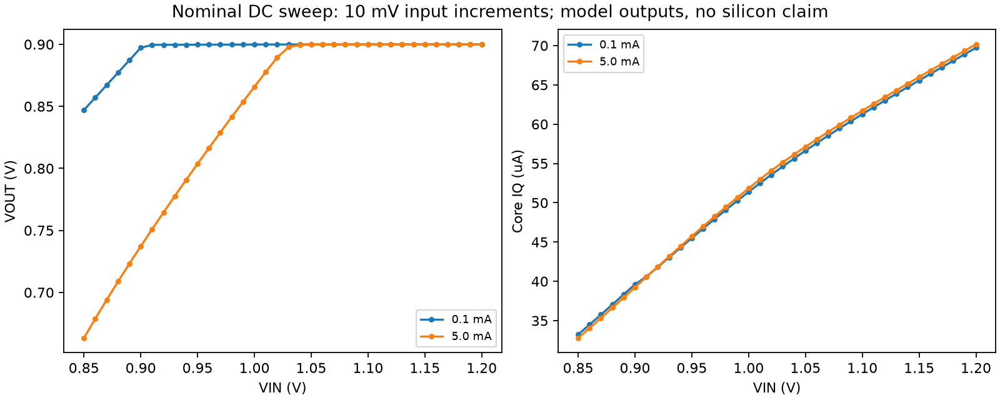

# A 130 nm CMOS Two-Stage LDO: Circuit Implementation and Automated Verification

## Abstract

A pre-layout low-dropout regulator is implemented with a PMOS differential amplifier, a complementary gate driver, and a PMOS pass device in 130 nm CMOS. Nine MOS instances, representing 44 parallel replicas, regulate a nominal 1.2 V input to 0.9 V using an ideal 0.45 V reference and an external ideal 1 nF output capacitor. Spectre verification covers 164 static/DC conditions and ten transients. The 45-point 1.2 V PVT matrix has a minimum native phase margin of 63.89 deg. For a nominal 0.1–5 mA load pulse with 100 ns ramps, undershoot and overshoot are 126.823 and 117.720 mV. Recovery to 0.9 V±1% is 1.690/2.318 us from ramp end. The study retains the 10 pF instability and high-temperature unload secondary droop. Literature-defined transient figures of merit are evaluated with explicit capacitance, load-step, and IQ conventions; no silicon or layout result is claimed.

**Index terms—** CMOS LDO, error amplifier, compensation, load transient, loop stability, automated verification.

## I. Design objective and implementation scope

This project demonstrates transistor sizing, negative-feedback design, supply/load-transient analysis, and reproducible numerical verification. The objective is to evaluate the tradeoff between driver authority, quiescent current, compensation, and capacitive load. A large transient spike is reported alongside its eventual recovery; it is not hidden by a steady-state accuracy figure.

VIN=1.2 V, VOUT=0.9 V, and the 100 uA–5 mA load range are the principal test conditions. A nominal 1.2 V transistor-family context is used for voltage-envelope reporting. The ideal reference, current-sink load, zero-ESR external output capacitor, and ideal compensation passives are explicit simulation conditions. Reference circuitry, a droop detector, capacitor area, and layout implementation are not part of this revision.

## II. Architecture and block functions



**Fig. 1.** Differential amplifier, gate driver, pass device, resistor feedback, bias, and active compensation. The external capacitor and load are testbench elements. [PNG](results/figures/architecture.png).

| Block | Circuit | Function |
|---|---|---|
| Bias | M5 +100 kohm RBIAS | Establishes BIAS for the amplifier tail and driver pull-up. |
| Input/gain stage | PMOS M2/M3, tail M4, NMOS mirror M6/M7 | Compares VREF with the divided output and develops EAOUT. |
| Gate driver | PMOS M8 and NMOS M9 | Charges/discharges the pass gate with a second gain/inversion stage. |
| Pass element | PMOS M1 | Supplies load current; gate capacitance and on-conductance affect speed and dropout. |
| Feedback | 200/200 kohm divider | Sets VOUT=VREF(1+RTOP/RBOT)=0.9 V. |
| Compensation | 36 kohm/18 pF series branch; auxiliary 0.1 pF and 1 kohm/1 fF | Shapes the loop response at the amplifier/gate/output nodes. |

An increase in feedback voltage reduces EAOUT, raises the pass gate, and reduces output current, establishing negative feedback. The [complete nine-instance schematic, functions, dimensions, and body connections](design.md) disclose Wunit, L, m, nf, and total width for every MOS instance. The feedback analysis probe separates the node names FB and FBIN without a DC voltage drop.

## III. Verification method and sampled coverage

The completed revision comprises **164 static/DC conditions and 10 transient cases**, with 289,248 saved transient samples and 20 measured events. Simulation completion is separate from circuit performance. Recorded warnings remain in the per-case counts; zero-error completion does not mean zero warnings.

| Matrix | Conditions | VOUT range | Core IQ range | Worst native PM / GM |
|---|---:|---:|---:|---:|
| VIN=1.2 V; 5 process corners × 3 temperatures × 3 loads | 45 | 0.899933–0.900087 V | 63.72–77.19 uA | 63.89 deg / 16.22 dB |
| VIN=1.1 V; 5 corners × 3 temperatures × 2 loads | 30 | 0.899800–0.900040 V | 54.69–68.97 uA | 66.23 deg / 19.87 dB |

Temperatures are −40/27/125 C. The 1.2 V matrix uses 0.1/1/5 mA; the 1.1 V matrix uses 0.1/5 mA. These are discrete model samples, not continuous-range closure, mismatch yield, or silicon measurements. At VIN=1.1 V, slow/slow −40 C light load, the tail-device saturation margin is only about 0.44 mV. Successful DC regulation does not establish ample lower-supply headroom.

## IV. Transient results and tradeoffs

Load changes occur at 5 and 30 us, and observation ends at 60 us. Results below use the complete saved samples with explicit event windows. Recovery starts at **ramp end** and uses the last linearly interpolated entry into the fixed 0.891–0.909 V band, remaining in that band only to the event observation end.

| Load case, external Cout=1 nF | Up undershoot | Down overshoot | Up / down recovery | Unload secondary undershoot |
|---|---:|---:|---:|---:|
| Nominal, 100 ns ramp | 126.823 mV | 117.720 mV | 1.690 / 2.318 us | 15.472 mV |
| Nominal, 10 ns ramp | 132.183 mV | 121.145 mV | 1.742 / 2.419 us | 17.295 mV |
| Slow/slow, 125 C, 100 ns ramp | 165.554 mV | 157.242 mV | 1.954 / 3.439 us | **47.707 mV** |

Secondary undershoot is the minimum after the unload event's primary VOUT maximum. The high-temperature result shows why primary peak reduction alone is an incomplete objective. Four corner transients are available; this does not establish transient closure across the whole PVT matrix.

For input steps 1.1→1.2→1.1 V with 100 ns ramps, light-load overshoot/undershoot are 26.104/24.988 mV and heavy-load values are 47.362/43.139 mV. These are time-domain line responses, not a PSRR measurement.



## V. Output-capacitance stability boundary

| Cout | Load | Native state | Native PM | Native GM |
|---|---:|---|---:|---:|
| 1 nF | 0.1 / 1 / 5 mA | stable at all three points | 72.44 / 76.17 / 74.76 deg | 38.46 / 23.19 / 18.47 dB |
| 100 pF | 0.1 mA | stable | 67.62 deg | 18.55 dB |
| 100 pF | 1 mA | stable, inadequate margin | 15.72 deg | 3.71 dB |
| 100 pF | 5 mA | stable, inadequate margin | 6.62 deg | 1.27 dB |
| 10 pF | 0.1 / 1 / 5 mA | **unstable at all three points** | null | null |

PM≥60 deg and GM≥10 dB were exploratory screening goals. The native unstable classifications and missing margins are preserved. A native stable classification with small margins is not an application-wide success. The principal supported test condition remains 1 nF; a minimum acceptable capacitor between 100 pF and 1 nF has not been established. This revision did not repeat small-C transient failure runs.

## VI. Static, frequency-domain, and numerical results

- Nominal load regulation uses the 0.1–5 mA endpoints: −0.01185 mV/mA. Nominal line regulation over VIN=1.1–1.2 V is 0.3753 mV/V at 0.1 mA and 0.4766 mV/V at 5 mA.
- Dropout is a 1% VOUT reduction relative to the same load at VIN=1.2 V. The 10 mV VIN sweep brackets its transition at 0.89–0.90 V for light load and 1.02–1.03 V for heavy load. Interpolation does not justify finer physical precision.
- Core IQ is supply current minus commanded load current, including amplifier, bias, driver, and divider. Ideal-reference power is outside this measurement.
- PSRR is −20log10|VOUT(ac)/VIN(ac)|. Reference supply coupling is idealized. Output RMS noise integrates sampled ASD squared over **10 Hz–100 MHz**; light/heavy values are 166.98/352.99 uV RMS, without physical reference noise.
- Matched maxstep checks use 5 versus 2.5 ns for the 100 ns ramp, and 1 versus 0.5 ns for the 10 ns ramp. Maximum change in a primary VOUT peak is about 11.864 uV. Maximum pointwise VOUT differences between saved interpolants are 56.312/30.503 uV respectively. These finite refinements are numerical sensitivity checks, not asymptotic or physical accuracy guarantees.
- Layout parasitics, capacitor area, ESR sensitivity, mismatch, real reference, startup, and device reliability qualification are outside the reported validation.





## VII. Figures of merit and comparison boundaries

Two published equations use different definitions and are kept separate. Let **U** be the load-up undershoot and **O** the unload overshoot, both relative to the existing fixed 0.9 V target. Let IQ* be the **larger of the two matching endpoint static core-IQ values**, rather than an IQ taken from a different corner. Both endpoint values and their average are retained in the [derived JSON](results/figures_of_merit.json).

The sum/max-load definition in [1, Eq. (14)] is evaluated as:

```text
FoMsum,max = COUT × (U + O) × IQ* / Imax²                         [s]
```

The single-spike/load-step definition in [2, Table I footnote] is evaluated separately for each event:

```text
FoMspike,step = COUT × ΔVsingle × IQ* / (Ihigh − Ilow)²           [s]
```

Here COUT=1 nF is the **declared external ideal test capacitance**, Imax=5 mA, and ΔI=4.9 mA. These are different denominators: replacing Imax² with ΔI² increases an otherwise identical value by **4.123%**. The first equation uses U+O; the second uses one spike, or max(U,O) for its worst-event summary. Their numerical values must not be compared as if they were one FoM.

| Case | Ramp | IQ* | Sum/max-load FoM | Single-spike/step FoM, up / down | Measured recovery, up / down |
|---|---:|---:|---:|---:|---:|
| TT, 27 C | 100 ns | 70.162 uA | 686.310 ps | 370.604 / 344.005 ps | 1.690 / 2.318 us |
| TT, 27 C | 10 ns | 70.162 uA | 710.964 ps | 386.267 / 354.012 ps | 1.742 / 2.419 us |
| SS, 125 C | 100 ns | 71.569 uA | 924.083 ps | 493.480 / 468.705 ps | 1.954 / 3.439 us |

Both capacitance-based equations omit ramp time explicitly, so edge time is reported beside every value. They also do not include unload secondary droop or a recovery-band definition. **COUT·ΔV/ΔI is a charge-response proxy, not the measured settling time**; for the nominal 100 ns case it is approximately 25.88/24.02 ns per edge, whereas the measured recoveries above are in microseconds.

IQ* includes amplifier, driver, bias, and divider current; reference power is outside scope. The capacitance does not claim extracted device/interconnect parasitics. The fixed-target peak convention differs slightly from a pre-event-mean convention because finite DC load regulation exists. Comparison with another publication requires the same peak baseline, edge, capacitance scope, load range, IQ convention, and simulated/measured status. These values are descriptive normalized metrics, not a state-of-the-art ranking.

The edge/process-normalized equation in [3, Eq. (10)] is retained as **unavailable** because a qualified minimum technology channel length has not been established. The nominal 130 nm node and the 150 nm drawn pass length are not substituted for that quantity. Area-normalized and extracted-capacitance FoMs are also unavailable. The 10 pF unstable cases retain null native margins and do not acquire a transient FoM from an unrun waveform.

## VIII. Reproducible methods

Python 3.10 or later is sufficient for numerical analysis. Install matplotlib only if figures are desired. From the repository root:

```text
python -B projects/ldo-130nm/scripts/reproduce.py --outdir reproduced/ldo
```

For measurements without plots:

```text
python -B projects/ldo-130nm/scripts/reproduce.py --outdir reproduced/ldo-numeric --no-plots
```

Choose a fresh output directory. The script remeasures all 20 events, checks agreement with the retained exports, recomputes the two full-wave comparisons, retains native scalar stability results, and generates `summary.json`, `events.csv`, `convergence.json`, `figures_of_merit.json`, `figures_of_merit.csv`, and optional waveform/circuit figures. Transient, loop-gain, PSRR, and noise plots use exported samples; native margins and static PVT scalars are published simulator results, not re-created simulations. CSV inputs use SI units; sampled time/frequency axes are strictly increasing.

The [committed results](results/) were regenerated with this script. The public data can reproduce measurements and plots; rerunning the transistor simulations requires an independently configured, authorized technology environment. Circuit performance and original simulator completion are not independently certified by this post-processing package.

## IX. References

[1] Y. Zhang et al., “A 640 nA IQ Output-Capacitor-Less Low Dropout (LDO) Regulator ...,” *Micromachines*, vol. 15, art. 1019, 2024, Eq. (14). [DOI](https://doi.org/10.3390/mi15081019).

[2] Y. Yao et al., “A Fully Integrated 5pF Output Capacitor, MOS-only Reference, 55-nm LDO ...,” *IEICE Electronics Express*, vol. 19, art. 20220051, 2022, Table I footnote. [DOI](https://doi.org/10.1587/elex.19.20220051).

[3] C. Hu et al., “A Fully Integrated Low-Dropout Regulator with Improved Load Regulation and Transient Responses,” *Micromachines*, vol. 13, no. 10, 1668, 2022, Eq. (10). [DOI](https://doi.org/10.3390/mi13101668).
