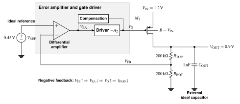

# 130 nm CMOS LDO

A transistor-level analog regulator with a PMOS differential amplifier, complementary gate driver, PMOS pass device, resistor feedback and compensation. The nominal operating point is **1.2 V input, 0.9 V output and 0.1–5 mA load**, using an ideal 0.45 V reference and an external ideal 1 nF output capacitor.

This page describes the **historical r6 pre-layout study**: 9 MOS instances with 44 parallel replicas. The published measurements and device inventory belong to that revision.

| Published r6 result | Conditions | Value |
| --- | --- | ---: |
| Minimum native phase / gain margin | 45 points; VIN = 1.2 V, five corners, −40/27/125 °C, 0.1/1/5 mA, 1 nF | 63.89° / 16.22 dB |
| Load-up undershoot / unload overshoot | TT, 27 °C; 0.1 ↔ 5 mA, 100 ns ramps, 1 nF | 126.823 / 117.720 mV |
| Load-up / unload recovery | Same event; 0.9 V ±1%, measured from ramp end | 1.690 / 2.318 µs |
| High-temperature unload secondary droop | SS, 125 °C; 100 ns ramps, 1 nF | 47.707 mV |
| Static/DC and transient coverage | Completed configurations / runs | 164 / 10 |

The minimum margins may occur at different sampled operating points. Recovery means the final interpolated entry into the error band through the end of the event's observation window. Completed-case counts describe coverage; they do not establish full-spec closure. At 10 pF, all three sampled load points are unstable; 100 pF has inadequate margins at 1 and 5 mA.

## Read the design



- [Circuit implementation and device sizing](design.md): block functions, negative-feedback direction, complete transistor connections, W/L, multiplicity and finger count.
- [Detailed results and measurement definitions](results.md): static behavior, load and line transients, loop stability, PSRR, noise, numerical sensitivity and FoM equations.
- [Machine-readable circuit](data/circuit.json), [static results](data/static.json) and [transient index](data/transients/index.json): the published inputs behind the figures.
- [Derived FoM data](results/figures_of_merit.json): separately defined sum/max-load and single-spike/load-step metrics, with the matching IQ and edge conditions.
- [Technical report and build instructions](../../report/README.md): the two-column portfolio report.

## Reproduce the saved results

From the repository root, using Python 3.10 or later:

```sh
python -B projects/ldo-130nm/scripts/reproduce.py --outdir reproduced/ldo --no-plots
```

Choose a fresh output directory. The standard-library path remeasures 20 events from the retained transient exports, checks agreement with saved measurements, recomputes two waveform comparisons and writes the summary, event and FoM tables. Remove `--no-plots` after installing the repository requirements to generate figures. Native stability scalars remain published simulator measurements.

See the [reproduction guide](../../docs/reproducibility.md) for the complete portfolio workflow.

## Verification scope

The amplifier, bias, driver and pass element use transistor models. The reference, current-sink load, output capacitor and compensation passives are ideal test conditions. This release does not establish layout/PEX performance, mismatch yield, reference startup or noise, reliability qualification, or silicon measurements. The external capacitor is not a claim of on-chip capacitance or area.

[Portfolio architecture](../../docs/architecture.md) · [Validation scope](../../docs/validation-scope.md) · [Portfolio overview](../../README.md)
