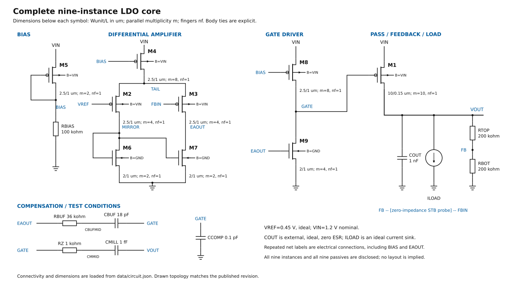

# Circuit implementation and sizing



**Fig. 2.** Complete core, compensation, feedback, and ideal load connections. Repeated node labels denote electrical connections. Every bulk terminal is explicitly labeled. [PNG](results/figures/schematic.png) · [machine-readable circuit](data/circuit.json).

## A. Block functions

| Block | Elements | Function and relevant tradeoff |
|---|---|---|
| Reference | Ideal 0.45 V source | Sets the error-amplifier input; reference startup, noise and power are outside this revision. |
| Bias | M5, RBIAS=100 kohm | Diode-connected PMOS and resistor establish BIAS. This node controls M4 tail current and M8 pull-up current; supply/temperature sensitivity therefore affects both stages. |
| Differential amplifier | M2/M3, M4, M6/M7 | PMOS pair compares VREF with FBIN. M4 supplies the tail; the NMOS mirror converts differential current to single-ended EAOUT. Gain and output swing depend on mirror and tail headroom. |
| Gate driver | M8/M9 | Biased PMOS pull-up and common-source NMOS sink charge/discharge the pass gate. M9 adds inversion and gain. More drive current costs IQ and can change overshoot and compensation. |
| Pass element | M1 | PMOS conducts VIN to VOUT. Its gate capacitance loads the driver, and its conductance sets current authority and dropout. Saturation is not required at every regulating point. |
| Feedback | RTOP/RBOT=200/200 kohm | Sets nominal VOUT=VREF(1+RTOP/RBOT)=0.9 V and contributes divider current to core IQ. |
| Compensation | RBUF/CBUF, RZ/CMILL, CCOMP | The main EAOUT–GATE branch shapes loop poles/zeros; small auxiliary branches are retained exactly. Stability depends strongly on external COUT and load. |
| Output/load | COUT, ideal current sink | External zero-ESR capacitor supplies transient charge. The current sink has infinite incremental AC resistance; VOUT/ILOAD is not its small-signal resistance. |
| Analysis probe | FB–FBIN | Zero-impedance loop-gain probe between divider and amplifier input. FB and FBIN have the same unperturbed DC voltage but are kept as distinct node names for analysis. |

The negative feedback direction is: **FB rises → EAOUT falls → M9 sink current falls → GATE rises → M1 conduction falls → VOUT falls**. The ideal reference and load are testbench elements; the gain stages, bias devices, driver, and pass device use transistor models.

## B. Complete MOS dimensions

There are **9 MOS schematic instances and 44 parallel replicas**, all with **nf=1**. Wunit is the drawn width of one one-finger replica; m is parallel multiplicity. The saved implementation uses:

```text
Wtotal = Wunit × nf × m
```

Changing m is not equivalent to declaring an extracted multi-finger layout. Dimensions are drawn design values, not fabricated or post-layout measurements.

| Device | Type / role | Wunit (um) | L (um) | m | nf | Wtotal (um) | Drain | Gate | Source | Body |
|---|---|---:|---:|---:|---:|---:|---|---|---|---|
| M1 | PMOS pass | 10 | 0.15 | 10 | 1 | 100 | VOUT | GATE | VIN | VIN |
| M2 | PMOS reference input | 2.5 | 1 | 4 | 1 | 10 | MIRROR | VREF | TAIL | VIN |
| M3 | PMOS feedback input | 2.5 | 1 | 4 | 1 | 10 | EAOUT | FBIN | TAIL | VIN |
| M4 | PMOS tail | 2.5 | 1 | 8 | 1 | 20 | TAIL | BIAS | VIN | VIN |
| M5 | PMOS bias diode | 2.5 | 1 | 2 | 1 | 5 | BIAS | BIAS | VIN | VIN |
| M6 | NMOS mirror diode | 2 | 1 | 2 | 1 | 4 | MIRROR | MIRROR | GND | GND |
| M7 | NMOS mirror output | 2 | 1 | 2 | 1 | 4 | EAOUT | MIRROR | GND | GND |
| M8 | PMOS driver pull-up | 2.5 | 1 | 8 | 1 | 20 | GATE | BIAS | VIN | VIN |
| M9 | NMOS driver sink | 2 | 1 | 4 | 1 | 8 | GATE | EAOUT | GND | GND |

M2/M3 bodies connect to VIN, **not TAIL**. The other PMOS bodies connect to VIN; all NMOS sources and bodies connect to ground. A nominal 1.2 V supply-family context is used for sampled voltage-envelope reporting; it is not an absolute-maximum or reliability specification.

## C. Complete passive and analysis connections

| Element | First node | Second node | Value / behavior |
|---|---|---|---:|
| RBIAS | BIAS | GND | 100 kohm |
| RTOP | VOUT | FB | 200 kohm |
| RBOT | FB | GND | 200 kohm |
| RBUF | EAOUT | CBUFMID | 36 kohm |
| CBUF | CBUFMID | GATE | 18 pF |
| RZ | GATE | CMMID | 1 kohm |
| CMILL | CMMID | VOUT | 1 fF |
| CCOMP | GATE | GND | 0.1 pF |
| COUT | VOUT | GND | 1 nF nominal; external ideal, zero ESR |
| Loop probe | FB | FBIN | Zero impedance at the unperturbed operating point |

The capacitor study changes only COUT to 100 pF or 10 pF. It does not substitute new amplifier sizing. All passives are ideal in the reported simulations. At VIN=1.1 V, the slow/slow −40 C light-load tail margin is only about 0.44 mV; native DC/STB results should not be read as ample bias compliance below the sampled conditions.

## D. Recreate the drawings

```text
python -B projects/ldo-130nm/scripts/render_circuits.py --outdir reproduced/ldo-circuits
```

The renderer validates the device terminals, multiplicity semantics, and passive connections against [circuit.json](data/circuit.json) before drawing. It emits SVG and PNG with black lines, white backgrounds, orthogonal wiring, and one blue annotation color. It does not run circuit simulation.
