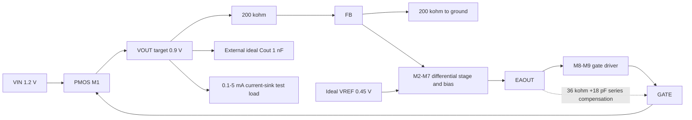

# Circuit structure

This is the transistor-level core used for the published revision. Device labels below describe circuit roles; dimensions are **total drawn width**, with parallel fingers/instances combined. Every bulk connection is explicit. The table is a circuit design description, not a simulator deck.

| Device | Type / role | Drain | Gate | Source | Bulk | Total W (um) | L (um) |
|---|---|---|---|---|---|---:|---:|
| M1 | PMOS pass device | VOUT | GATE | VIN | VIN | 100 | 0.15 |
| M2 | PMOS reference input | MIRROR | VREF | TAIL | VIN | 10 | 1 |
| M3 | PMOS feedback input | EAOUT | FB | TAIL | VIN | 10 | 1 |
| M4 | PMOS input-stage tail | TAIL | BIAS | VIN | VIN | 20 | 1 |
| M5 | Diode-connected PMOS bias | BIAS | BIAS | VIN | VIN | 5 | 1 |
| M6 | Diode-connected NMOS mirror | MIRROR | MIRROR | GND | GND | 4 | 1 |
| M7 | NMOS mirror output | EAOUT | MIRROR | GND | GND | 4 | 1 |
| M8 | PMOS gate-driver pull-up | GATE | BIAS | VIN | VIN | 20 | 1 |
| M9 | NMOS common-source gate driver | GATE | EAOUT | GND | GND | 8 | 1 |

The bias resistor is 100 kohm from BIAS to ground. RTOP/RBOT are 200 kohm each. The active compensation branch is EAOUT→36 kohm→18 pF→GATE. A small auxiliary compensation path has GATE→1 kohm→1 fF→VOUT, and a 0.1 pF auxiliary capacitor. All compensation passives are ideal in these simulations.

The feedback direction was checked from the saved DC connections and operating points: an increase in FB reduces EAOUT, weakens the NMOS driver sink, raises GATE, reduces PMOS pass conduction, and decreases VOUT. The ideal test load is a current sink; VOUT/ILOAD must not be treated as its incremental AC resistance.

The pass device can enter triode during regulation. Saturation and terminal-voltage samples should be interpreted with the actual condition and nominal supply-family context, without implying device reliability signoff. The published 1.1 V low-headroom cases are especially important when assessing bias and driver compliance.
