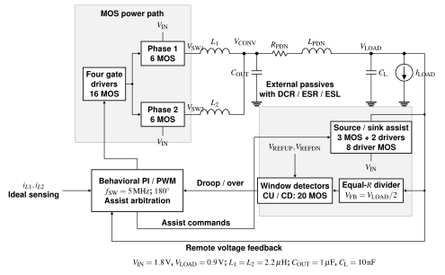

# PDN-Aware Two-Phase Buck With Fast Transient Assist

A 130 nm CMOS study of two interleaved synchronous power stages supplying a remote load through a parameterized PDN. Transistor-level power bridges, drivers, window detectors and source/sink assist operate with **behavioral PI/PWM control and ideal current sensing**.

This page describes the **historical r8/r9 pre-layout studies**. Both contain 59 MOS instances. r9 adds 1 kohm/2 kohm source/sink assist gate resistances while retaining the r8 transistor dimensions.

Nominal conditions are **VIN = 1.8 V, VOUT = 0.9 V and 5 MHz per phase**, with 2.2 µH per phase, 1 µF converter capacitance, 10 nF load-side capacitance and a 0.1 ohm/0.5 nH series PDN. The external passives and PDN are parameterized test models.

| Published matched comparison | Peak OFF → ON | Recovery OFF → ON |
| --- | ---: | ---: |
| r8 nominal load increase, 100 ns edge: droop | 143.37 → 107.39 mV | 7.55 → 13.74 µs |
| r8 nominal load decrease, 100 ns edge: overshoot | 84.17 → 52.56 mV | 16.69 → 12.58 µs |
| r8 hard-PDN load decrease, 10 ns edge: overshoot | 86.89 → 110.30 mV | 16.38 → 12.88 µs |
| r9 hard-PDN load decrease, 10 ns edge: overshoot | 87.13 → 94.55 mV | 16.48 → 12.89 µs |

OFF and ON within each row share the stimulus, components, solver and measurement window. ON combines local MOS assist with a coordinated PI-state handoff. Nominal load-up droop improves by 25.10%, while recovery is 82.06% slower. The hard-PDN unload case retains an overshoot penalty; r9 reduces but does not eliminate it. Recovery is measured from event start within the finite observation window.

## Read the design

[Spectre inputs and case manifests](simulation/README.md) contain a nominal assist OFF/ON pair and the full r8/r9 case settings.



- [Circuit implementation and device inventory](design.md): each block's function, all 59 MOS dimensions and terminal connections, and the r8/r9 circuit differences.
- [Detailed results and acceptance limits](results.md): matched on/off comparisons, event energy, normalized metrics, adverse cases and solver sensitivity.
- [Device table](data/mos_dimensions.csv), [r8 hardware](data/r8_hardware.csv) and [r9 hardware](data/r9_hardware.csv): numerical sizing and connectivity.
- [Behavioral controller](controller/buck_control.va) and [selected parameters](data/selected_parameters.json): the implemented control algorithm and effective parameter overrides.
- [Matched-comparison measurements](data/comparison_metrics.json) and [assist-port work](data/assist_port_work.json): condition-bound numerical evidence.
- [Technical report and build instructions](../../report/README.md): the two-column portfolio report.

## Reproduce the saved results

From the repository root, using Python 3.10 or later:

```sh
python -B projects/two-phase-buck/scripts/reproduce.py --outdir reproduced/buck --no-plots
```

Choose a fresh output directory. The standard-library path verifies asset hashes, case counts, pair arithmetic and device-width arithmetic, then writes the numerical summary and comparison tables. Remove `--no-plots` after installing the repository requirements to generate figures. This analysis consumes retained measurements; it does not independently reparse full simulator waveforms. The six display waveform CSVs are decimated and must not be used to remeasure energy or recovery.

See the [reproduction guide](../../docs/reproducibility.md) for the complete portfolio workflow.

## Verification scope

r8 completed 47 cases and 24 matched comparisons; r9 completed eight cases and four matched comparisons. r9 does not inherit r8 coverage. All 141 r8 steady-window means are within 0.9 V ±1%, but 127/141 finite-periodicity diagnostics were not accepted. Solver sensitivity is retained and does not establish convergence or switching-loop stability signoff.

Complete physical efficiency remains unavailable because controller, reference and sensing power are not fully modeled. Layout/PEX, extracted package behavior, EM/IR, reliability and hardware performance have not been established by these studies.

[Portfolio architecture](../../docs/architecture.md) · [Validation scope](../../docs/validation-scope.md) · [Portfolio overview](../../README.md)
