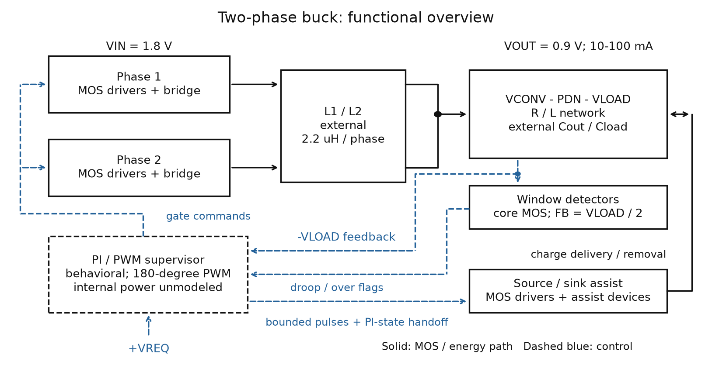
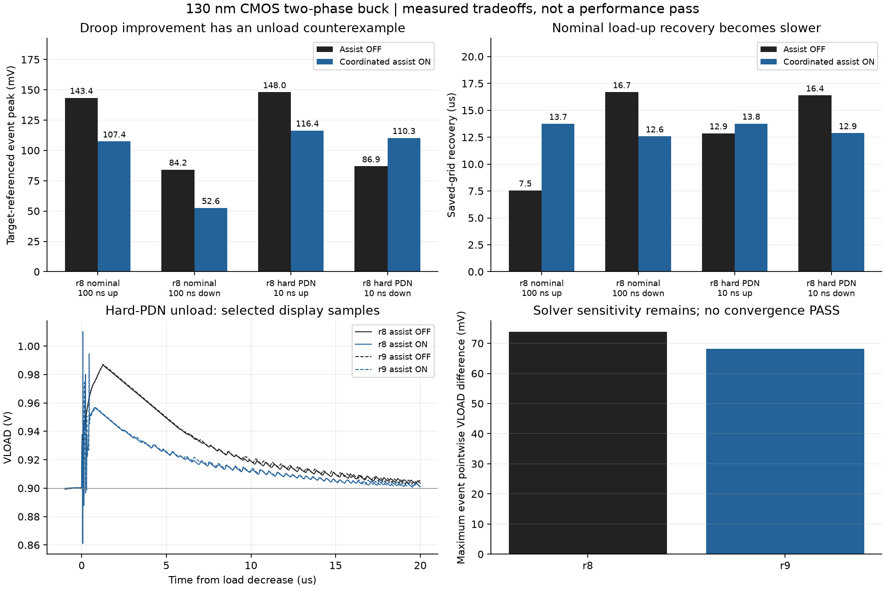

# PDN-Aware Two-Phase Buck With Fast Transient Assist

## Abstract

This 130 nm CMOS study evaluates event-driven charge assist in a two-phase synchronous buck feeding a remote load through a parameterized power-delivery network (PDN). The power bridges, gate drivers, voltage-window detectors and source/sink assist use transistor models. PI/PWM control and current sensing are behavioral. A 47-case matrix demonstrates both nominal droop improvement and a hard-PDN unload counterexample. An eight-case gate-resistance exploration reduces that counterexample without establishing broader closure. Results are pre-layout simulations; physical efficiency and switching-loop stability signoff are unavailable.

## Architecture



[Detailed electrical architecture](figures/architecture.png) | [Vector drawing](figures/architecture.svg)

Two interleaved bridges feed VCONV through separate inductors. A series PDN connects VCONV to VLOAD, where feedback and primary transient measurements are taken. Core-MOS window detectors qualify low/high output events. I/O-MOS assist devices deliver or remove charge directly at VLOAD, while a coordinated mode changes the voltage-loop PI state.

The [implementation document](design.md) describes each block and lists **all 59 MOS instances**, including Wunit/L/m/nf/Wtotal and D/G/S/B. The [device CSV](data/mos_dimensions.csv) provides the same table numerically. The electrical drawing uses aggregate bank symbols; it is not a routed layout.

## Implementation

| Block | Implementation | MOS instances |
| --- | --- | ---: |
| Two power bridges | Four parallel PMOS high-side and two parallel NMOS low-side instances per phase | 12 |
| Gate drivers | Six two-stage I/O CMOS inverter chains | 24 |
| Window detectors | Two PMOS-input amplifiers with NMOS mirror loads and restoring inverters | 20 |
| Source/sink assist | Two parallel PMOS sourcing instances and one NMOS sinking instance | 3 |
| PI/PWM, timing, arbitration | Verilog-A algorithm; ideal 1 V/A current sensing | Behavioral |

Nominal conditions are VIN = 1.8 V, VOUT = 0.9 V, two phases at 5 MHz, L = 2.2 uH per phase and Cout = 1 uF. The load-side capacitance is 10 nF; nominal PDN R/L is 0.1 ohm/0.5 nH. DCR, ESR, ESL and all case-specific changes are recorded in [r8 measurements](data/r8_measurements.json).

The selected controller applies a 40 mA PI-state handoff in mode 2. Its two-microsecond arbitration interval does not bound the subsequent influence of that state change. [Effective parameters](data/selected_parameters.json) override defaults in the [controller source](controller/buck_control.va). Internal controller/digital power is unmodeled. The r9 variant adds 1 kohm/2 kohm source/sink gate resistances while retaining the 59 MOS dimensions.

## Results

The r8 matrix completed **47 cases and 24 matched comparisons**: 94 events, 141 steady windows, 329 numerical warnings and no integrity failures. Completion is distinct from performance acceptance. All steady-window voltage means lie within 0.9 V ±1%, but 127/141 finite-periodicity diagnostics were not accepted.

The r9 exploration completed **eight cases and four matched comparisons** at nominal process and 27 °C, including nominal/hard-PDN events and two finer-solver cases. It does not inherit r8 matrix coverage.



### Performance table

OFF and ON within a row use the same target, load/input PWL, component values, solver and observation window. ON combines local MOS assist with coordinated PI-state handoff; its effect cannot be attributed to either mechanism alone.

| Revision / event | Peak OFF (mV) | Peak ON (mV) | Relative peak reduction | Recovery OFF / ON (us) |
| --- | ---: | ---: | ---: | ---: |
| r8 nominal, 100 ns load increase: droop | 143.37 | 107.39 | 25.10% | 7.55 / 13.74 |
| r8 nominal, 100 ns load decrease: overshoot | 84.17 | 52.56 | 37.56% | 16.69 / 12.58 |
| r8 hard PDN, 10 ns load increase: droop | 148.03 | 116.44 | 21.34% | 12.86 / 13.76 |
| r8 hard PDN, 10 ns load decrease: overshoot | 86.89 | 110.30 | −26.94% | 16.38 / 12.88 |
| r9 hard PDN, 10 ns load decrease: overshoot | 87.13 | 94.55 | −8.52% | 16.48 / 12.89 |

Nominal load-up droop improves while recovery increases by 82.06%. The r8 hard-PDN unload event worsens peak overshoot by 26.94%. The r9 resistance change reduces the overshoot penalty in its own matched pair; it does not eliminate that penalty.

### Comparison metrics and FoM applicability

A universal efficiency/area/transient FoM is **not assigned**: controller power and routed area are unavailable, and saved trajectories are not fully converged. The following are explicitly defined, matched-condition diagnostics rather than a literature benchmark or composite score. Let P be target-referenced droop on a load increase or overshoot on a load decrease, Vt the target, and tr the saved-grid recovery:

| Diagnostic | Definition | Interpretation |
| --- | --- | --- |
| Normalized peak | 100 P / Vt | Percentage of the target voltage |
| Relative peak reduction | 100 (P_OFF − P_ON) / P_OFF | Positive improves; negative worsens |
| Recovery cycles | fsw × tr | Normalizes observed recovery to the command period |
| Relative recovery change | 100 (tr_ON − tr_OFF) / tr_OFF | Positive is slower |
| Source / sink VLOAD-port work | Wup = ∫VLOAD Iup dt; Wdn = ∫VLOAD Idn dt | Positive Iup enters VLOAD; positive Idn exits VLOAD |
| Modeled supply-event energy difference | ΔEin = Ein_ON − Ein_OFF | Finite-window rail energy; not assist-only loss or physical efficiency |

For r8 nominal load-up, normalized peak changes from **15.93% to 11.93%**, recovery from **37.74 to 68.70 cycles**, source-assist VLOAD-port work is **39.32 nJ**, and modeled supply-event energy increases **46.44 nJ**. [All derived comparison metrics](data/comparison_metrics.json) retain their paired case names and finite windows. Source/sink work is retained from full-grid piecewise-linear VI integrals in [assist-port measurements](data/assist_port_work.json). Net assist work into VLOAD is Wup − Wdn; these terms do not include complete device loss or controller energy. Supply-event energy also depends on main-loop trajectories and stored-energy changes within the finite window.

### Numerical and physical limits

Four r8 and two r9 solver/strobe/tolerance comparisons quantify sensitivity. For r8, event-peak differences reach 1.245 mV, recovery differences 4.885 us, and event pointwise VLOAD differences 73.770 mV. These are not convergence PASS results. Finite steady means, burst/DCM diagnostics, and switching-loop stability are separate questions.

Physical overall efficiency remains **N/A**. Layout/PEX, extracted package PDN, EM/IR, device reliability and hardware validation have not been performed. Saved-grid terminal-voltage envelopes can miss inter-sample peaks. External L/C and ESR/ESL/DCR are parameterized test models.

## Reproducibility

From the repository root:

```sh
python -B projects/two-phase-buck/scripts/reproduce.py --outdir reproduced/buck
```

Python 3.10+ and Matplotlib reproduce the electrical architecture and result plots. Add `--no-plots` for standard-library checks and numerical output. Choose a new or empty directory. The command checks asset hashes, counts, pair arithmetic and device-width arithmetic, then generates `summary.json`, `comparison_metrics.csv` and figures.

The command consumes retained measurements; it does not rerun simulations or independently reparse simulator results. Six display waveform CSVs are decimated with event extrema and endpoints retained, and must not be used to recompute energy or recovery. Recovery uses the last saved out-of-band violation followed by linear boundary interpolation, measured from event start within the finite observation window.

The r8 measurement method distribution is 41 cases before the endpoint roundoff patch, four using that patch and two line cases using a separate PWL-tail roundoff patch. Those narrowly bounded endpoint changes and all original numeric results remain represented in the measurement tables. Rerunning transistor simulations requires your own authorized technology setup.
