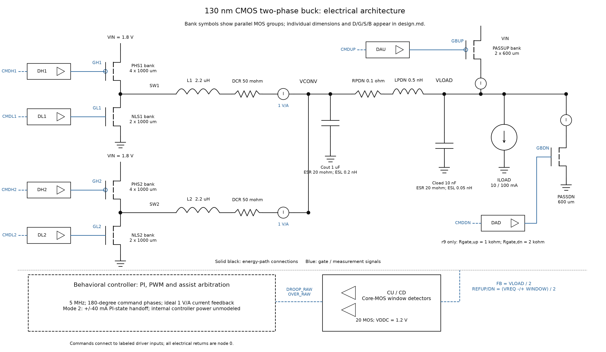

# Circuit implementation and device inventory

## Operating principle

The 130 nm CMOS study uses two synchronous MOS bridges, explicit transistor-level drivers and voltage-window detectors, and a behavioral current-reference/PWM controller. The load is sensed at VLOAD after a parameterized series PDN. r8 contains 59 MOS instances; r9 retains their dimensions and inserts 1 kohm/2 kohm in the source/sink assist gate paths.

## Device-size convention

`Wunit` is the width of one finger, `L` is channel length, `m` is the independent instance multiplier, and `nf` is finger count. All 59 instances have `nf = 1`; `Wtotal = Wunit × m × nf`. Values below are in micrometers. Parallel named instances remain separate rows. `0` denotes the common electrical return. These are design dimensions, not a routed layout area.

[Machine-readable device table](data/mos_dimensions.csv) | [Complete r8 component connectivity](data/r8_hardware.csv) | [Complete r9 connectivity](data/r9_hardware.csv)

## Power bridges

Twelve I/O MOS instances form two synchronous half bridges. Each phase has four parallel PMOS high-side units (4 mm aggregate width) and two parallel NMOS low-side units (2 mm aggregate width). Both phases drive external 2.2 uH inductors through 50 mohm DCR. Bulk terminals are tied to the corresponding source rail.

12 MOS instances.

| Instance | Type | Wunit (um) | L (um) | m | nf | Wtotal (um) | D | G | S | B |
| --- | --- | ---: | ---: | ---: | ---: | ---: | --- | --- | --- | --- |
| NLS1 | I/O NMOS | 10 | 0.5 | 100 | 1 | 1000 | SW1 | GL1 | 0 | 0 |
| NLS1_B1 | I/O NMOS | 10 | 0.5 | 100 | 1 | 1000 | SW1 | GL1 | 0 | 0 |
| NLS2 | I/O NMOS | 10 | 0.5 | 100 | 1 | 1000 | SW2 | GL2 | 0 | 0 |
| NLS2_B1 | I/O NMOS | 10 | 0.5 | 100 | 1 | 1000 | SW2 | GL2 | 0 | 0 |
| PHS1 | I/O PMOS | 10 | 0.5 | 100 | 1 | 1000 | SW1 | GH1 | VIN | VIN |
| PHS1_B1 | I/O PMOS | 10 | 0.5 | 100 | 1 | 1000 | SW1 | GH1 | VIN | VIN |
| PHS1_B2 | I/O PMOS | 10 | 0.5 | 100 | 1 | 1000 | SW1 | GH1 | VIN | VIN |
| PHS1_B3 | I/O PMOS | 10 | 0.5 | 100 | 1 | 1000 | SW1 | GH1 | VIN | VIN |
| PHS2 | I/O PMOS | 10 | 0.5 | 100 | 1 | 1000 | SW2 | GH2 | VIN | VIN |
| PHS2_B1 | I/O PMOS | 10 | 0.5 | 100 | 1 | 1000 | SW2 | GH2 | VIN | VIN |
| PHS2_B2 | I/O PMOS | 10 | 0.5 | 100 | 1 | 1000 | SW2 | GH2 | VIN | VIN |
| PHS2_B3 | I/O PMOS | 10 | 0.5 | 100 | 1 | 1000 | SW2 | GH2 | VIN | VIN |

## Gate drivers

Six two-stage CMOS inverter chains drive the two high-side gates, two low-side gates, source-assist gate and sink-assist gate. Each chain has four I/O MOS instances: a small first stage followed by a larger final stage. Two inversions preserve command polarity. Dead time and assist timing originate in the behavioral controller; inverter propagation and power-gate loading are transistor-model effects.

24 MOS instances.

| Instance | Type | Wunit (um) | L (um) | m | nf | Wtotal (um) | D | G | S | B |
| --- | --- | ---: | ---: | ---: | ---: | ---: | --- | --- | --- | --- |
| DAD_N1 | I/O NMOS | 4 | 0.5 | 2 | 1 | 8 | DAD_MID | CMDDN | 0 | 0 |
| DAD_N2 | I/O NMOS | 10 | 0.5 | 20 | 1 | 200 | GBDN | DAD_MID | 0 | 0 |
| DAD_P1 | I/O PMOS | 8 | 0.5 | 2 | 1 | 16 | DAD_MID | CMDDN | VIN | VIN |
| DAD_P2 | I/O PMOS | 20 | 0.5 | 20 | 1 | 400 | GBDN | DAD_MID | VIN | VIN |
| DAU_N1 | I/O NMOS | 4 | 0.5 | 2 | 1 | 8 | DAU_MID | CMDUP | 0 | 0 |
| DAU_N2 | I/O NMOS | 10 | 0.5 | 20 | 1 | 200 | GBUP | DAU_MID | 0 | 0 |
| DAU_P1 | I/O PMOS | 8 | 0.5 | 2 | 1 | 16 | DAU_MID | CMDUP | VIN | VIN |
| DAU_P2 | I/O PMOS | 20 | 0.5 | 20 | 1 | 400 | GBUP | DAU_MID | VIN | VIN |
| DH1_N1 | I/O NMOS | 4 | 0.5 | 2 | 1 | 8 | DH1_MID | CMDH1 | 0 | 0 |
| DH1_N2 | I/O NMOS | 10 | 0.5 | 20 | 1 | 200 | GH1 | DH1_MID | 0 | 0 |
| DH1_P1 | I/O PMOS | 8 | 0.5 | 2 | 1 | 16 | DH1_MID | CMDH1 | VIN | VIN |
| DH1_P2 | I/O PMOS | 20 | 0.5 | 20 | 1 | 400 | GH1 | DH1_MID | VIN | VIN |
| DH2_N1 | I/O NMOS | 4 | 0.5 | 2 | 1 | 8 | DH2_MID | CMDH2 | 0 | 0 |
| DH2_N2 | I/O NMOS | 10 | 0.5 | 20 | 1 | 200 | GH2 | DH2_MID | 0 | 0 |
| DH2_P1 | I/O PMOS | 8 | 0.5 | 2 | 1 | 16 | DH2_MID | CMDH2 | VIN | VIN |
| DH2_P2 | I/O PMOS | 20 | 0.5 | 20 | 1 | 400 | GH2 | DH2_MID | VIN | VIN |
| DL1_N1 | I/O NMOS | 4 | 0.5 | 2 | 1 | 8 | DL1_MID | CMDL1 | 0 | 0 |
| DL1_N2 | I/O NMOS | 10 | 0.5 | 20 | 1 | 200 | GL1 | DL1_MID | 0 | 0 |
| DL1_P1 | I/O PMOS | 8 | 0.5 | 2 | 1 | 16 | DL1_MID | CMDL1 | VIN | VIN |
| DL1_P2 | I/O PMOS | 20 | 0.5 | 20 | 1 | 400 | GL1 | DL1_MID | VIN | VIN |
| DL2_N1 | I/O NMOS | 4 | 0.5 | 2 | 1 | 8 | DL2_MID | CMDL2 | 0 | 0 |
| DL2_N2 | I/O NMOS | 10 | 0.5 | 20 | 1 | 200 | GL2 | DL2_MID | 0 | 0 |
| DL2_P1 | I/O PMOS | 8 | 0.5 | 2 | 1 | 16 | DL2_MID | CMDL2 | VIN | VIN |
| DL2_P2 | I/O PMOS | 20 | 0.5 | 20 | 1 | 400 | GL2 | DL2_MID | VIN | VIN |

## Window comparators

The CU and CD circuits each contain a PMOS-input differential pair, PMOS tail/bias devices, NMOS mirror load and two restoring inverters. CU produces DROOP_RAW when the divided output is below REFUP. CD produces OVER_RAW when the divided output exceeds REFDN. They operate from VDDC = 1.2 V. A reference-derived window and ideal voltage-controlled sources set threshold references; comparator offset, limited gain and delay remain transistor effects.

20 MOS instances.

| Instance | Type | Wunit (um) | L (um) | m | nf | Wtotal (um) | D | G | S | B |
| --- | --- | ---: | ---: | ---: | ---: | ---: | --- | --- | --- | --- |
| CD_NI1 | core NMOS | 1 | 0.15 | 1 | 1 | 1 | CD_MID | CD_EA | 0 | 0 |
| CD_NI2 | core NMOS | 1 | 0.15 | 1 | 1 | 1 | OVER_RAW | CD_MID | 0 | 0 |
| CD_NL | core NMOS | 2 | 1 | 4 | 1 | 8 | CD_MIR | CD_MIR | 0 | 0 |
| CD_NR | core NMOS | 2 | 1 | 4 | 1 | 8 | CD_EA | CD_MIR | 0 | 0 |
| CD_PB | core PMOS | 2.5 | 1 | 1 | 1 | 2.5 | CD_BIAS | CD_BIAS | VDDC | VDDC |
| CD_PI1 | core PMOS | 2 | 0.15 | 1 | 1 | 2 | CD_MID | CD_EA | VDDC | VDDC |
| CD_PI2 | core PMOS | 2 | 0.15 | 1 | 1 | 2 | OVER_RAW | CD_MID | VDDC | VDDC |
| CD_PL | core PMOS | 5 | 0.5 | 4 | 1 | 20 | CD_MIR | FB | CD_TAIL | VDDC |
| CD_PR | core PMOS | 5 | 0.5 | 4 | 1 | 20 | CD_EA | REFDN | CD_TAIL | VDDC |
| CD_PT | core PMOS | 2.5 | 1 | 16 | 1 | 40 | CD_TAIL | CD_BIAS | VDDC | VDDC |
| CU_NI1 | core NMOS | 1 | 0.15 | 1 | 1 | 1 | CU_MID | CU_EA | 0 | 0 |
| CU_NI2 | core NMOS | 1 | 0.15 | 1 | 1 | 1 | DROOP_RAW | CU_MID | 0 | 0 |
| CU_NL | core NMOS | 2 | 1 | 4 | 1 | 8 | CU_MIR | CU_MIR | 0 | 0 |
| CU_NR | core NMOS | 2 | 1 | 4 | 1 | 8 | CU_EA | CU_MIR | 0 | 0 |
| CU_PB | core PMOS | 2.5 | 1 | 1 | 1 | 2.5 | CU_BIAS | CU_BIAS | VDDC | VDDC |
| CU_PI1 | core PMOS | 2 | 0.15 | 1 | 1 | 2 | CU_MID | CU_EA | VDDC | VDDC |
| CU_PI2 | core PMOS | 2 | 0.15 | 1 | 1 | 2 | DROOP_RAW | CU_MID | VDDC | VDDC |
| CU_PL | core PMOS | 5 | 0.5 | 4 | 1 | 20 | CU_MIR | REFUP | CU_TAIL | VDDC |
| CU_PR | core PMOS | 5 | 0.5 | 4 | 1 | 20 | CU_EA | FB | CU_TAIL | VDDC |
| CU_PT | core PMOS | 2.5 | 1 | 16 | 1 | 40 | CU_TAIL | CU_BIAS | VDDC | VDDC |

## Source/sink assist

Two parallel PMOS source-assist instances deliver charge from VIN to AS_UP, followed by an ideal zero-voltage current sensor into VLOAD. One NMOS sink-assist instance removes charge from VLOAD through an ideal sensor and AS_DN. The controller qualifies detector flags, delays and bounds assist pulses, then coordinates the PI state. Source/sink port work describes charge delivered to or removed from VLOAD, not complete device loss.

3 MOS instances.

| Instance | Type | Wunit (um) | L (um) | m | nf | Wtotal (um) | D | G | S | B |
| --- | --- | ---: | ---: | ---: | ---: | ---: | --- | --- | --- | --- |
| PASSDN | I/O NMOS | 10 | 0.5 | 60 | 1 | 600 | AS_DN | GBDN | 0 | 0 |
| PASSUP | I/O PMOS | 10 | 0.5 | 60 | 1 | 600 | AS_UP | GBUP | VIN | VIN |
| PASSUP_B1 | I/O PMOS | 10 | 0.5 | 60 | 1 | 600 | AS_UP | GBUP | VIN | VIN |

## Comparator references and passive network

The divider uses RTOP = RBOT = 200 kohm. Its FB voltage is VLOAD/2 in the unloaded divider limit. Ideal controlled sources set REFUP = (VREQ − WINDOW)/2 and REFDN = (VREQ + WINDOW)/2; at VREQ = 0.9 V and WINDOW = 25 mV the nominal output thresholds are 0.875/0.925 V. They are desired reference levels, not a guarantee of measured comparator switching thresholds. Each comparator uses a 100 kohm bias resistor and a 20 fF EA-node capacitor.

The nominal power network uses two 2.2 uH inductors with 50 mohm DCR, Cout = 1 uF with ESR = 20 mohm and ESL = 0.2 nH, and series PDN R = 0.1 ohm / L = 0.5 nH. The remote 10 nF load capacitance has ESR = 20 mohm and ESL = 0.05 nH. Values are parameterized test conditions; each measurement case records its actual values.

## r9 gate-path change

The four final driver drain connections DAU_N2/DAU_P2 and DAD_N2/DAD_P2 become GBUP_DRV and GBDN_DRV respectively. A 1 kohm resistor connects GBUP_DRV to GBUP; a 2 kohm resistor connects GBDN_DRV to GBDN. PASSUP/PASSUP_B1/PASSDN gate names remain GBUP/GBDN. All 59 Wunit/L/m/nf values remain those of r8. r9 covers eight exploratory cases at nominal process and 27 °C, not the r8 47-case matrix.

## Behavioral controller boundary

[Verilog-A controller](controller/buck_control.va) implements soft start, filtered voltage/current feedback, outer voltage PI, per-phase current PI, 180-degree PWM scheduling, diode-emulation logic, current limits and assist arbitration. The current sensors are ideal 1 V/A voltage outputs. PI/PWM, sequencing, timing and the programmable reference are not transistor-level implementations. Internal digital/controller power is unmodeled.

Mode 2 applies one ±40 mA change to the voltage-loop integral state after a qualified detector event. A two-microsecond arbitration interval bounds an episode, while the changed PI state can influence later dynamics. A maximum of four 200 ns assist pulses, 15 ns qualification delay, 50 ns cooldown and 50 us startup blanking are configured in the selected case. Actual detector/driver/gate latency is affected by circuit dynamics and the 2 ns controller tick.

## Evidence boundary

Dimensions and connections are checked against the retained circuit inventory. Layout/PEX, extracted package PDN, EM/IR, device reliability and switching-loop stability signoff are not available. External L/C and their ESR/ESL/DCR are ideal component models. Physical overall efficiency remains N/A. Rerunning transistor simulations requires your own authorized technology setup.
